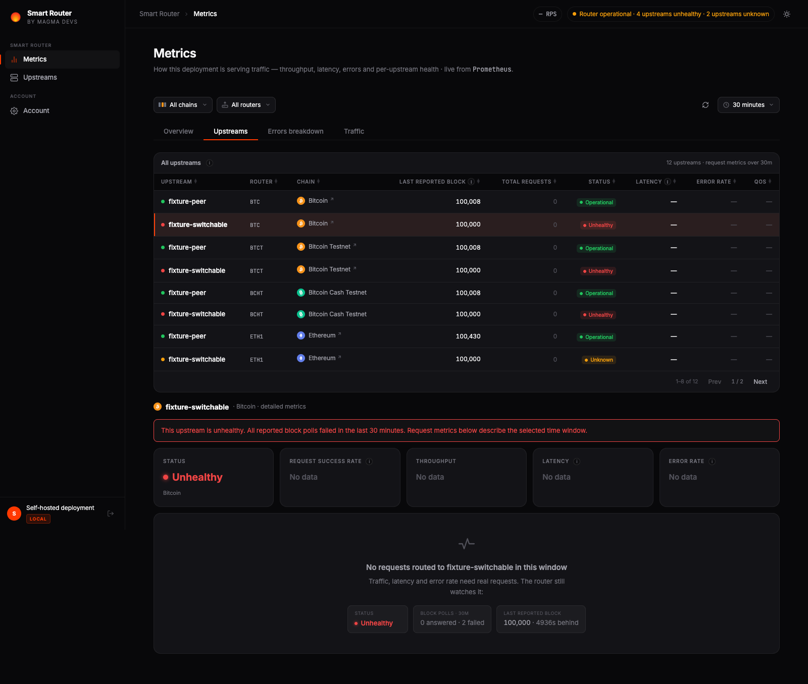
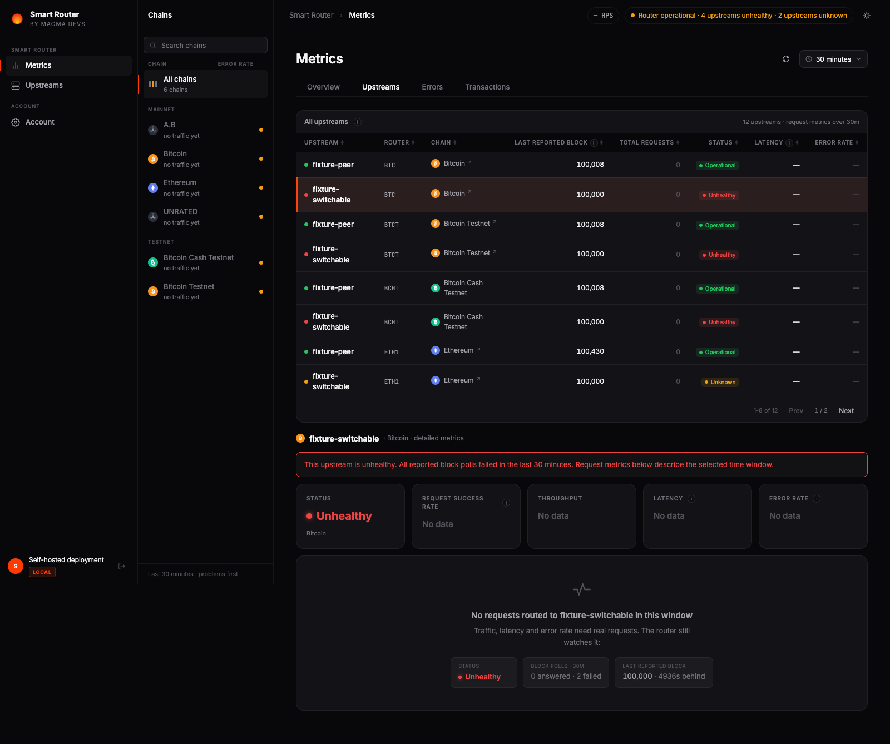
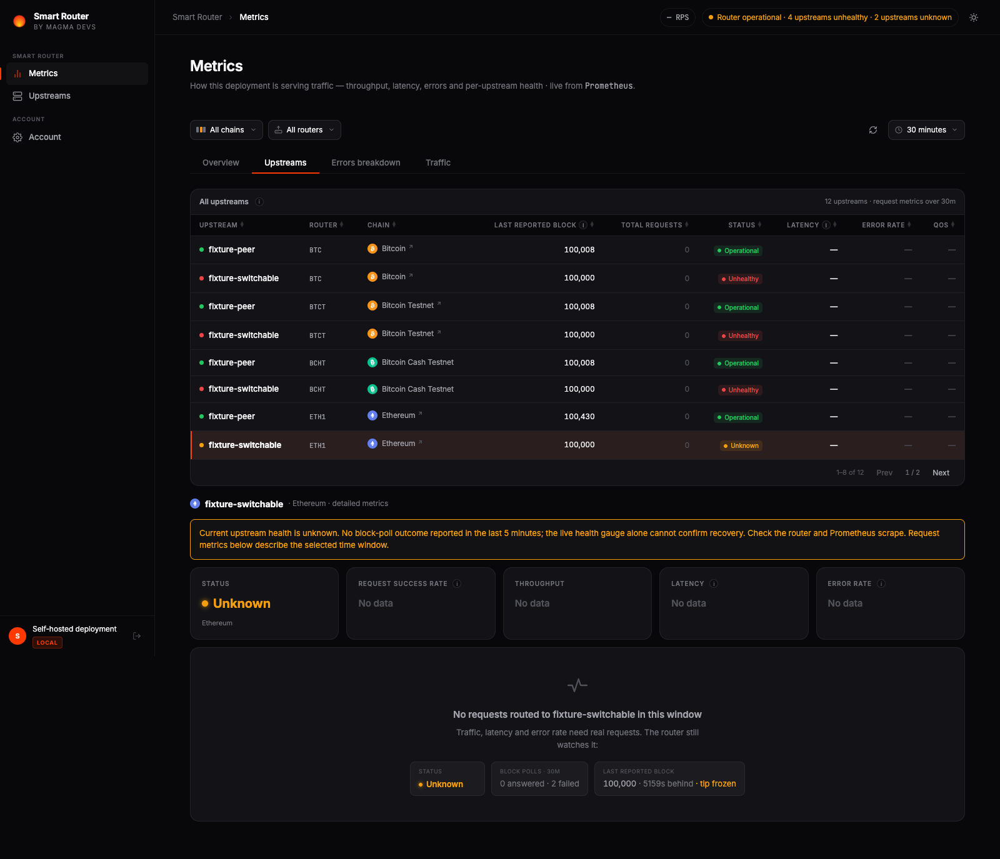
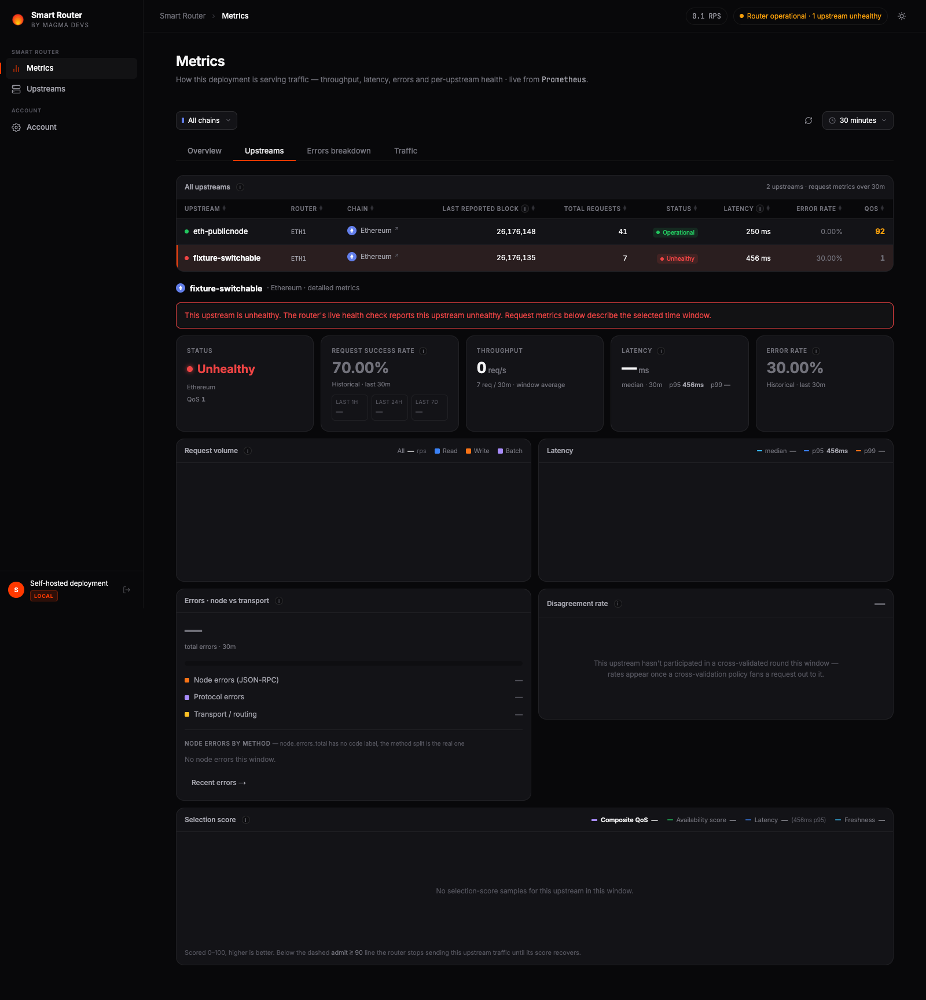
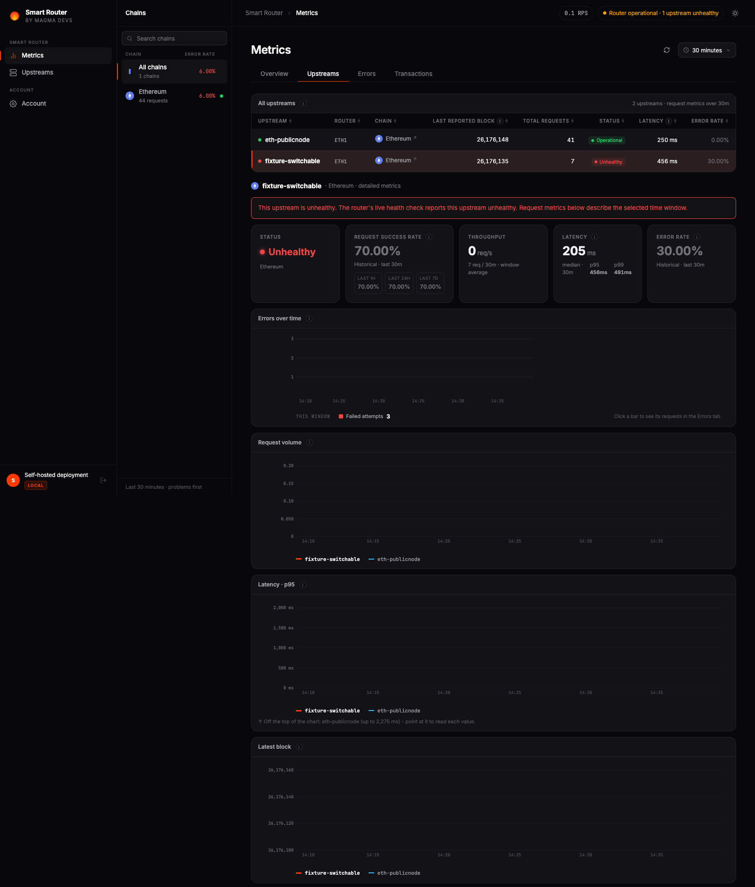

# MAG-4226 verification — 2026-10-11 and 2026-10-12

The archived Ethereum JSON below was captured on 2026-10-11 and imported
into this branch with neutral fixture identifiers on 2026-10-12. See
[evidence provenance](./evidence/provenance.json). Screenshots are fresh
captures of the updated production API and unchanged production UI source
with neutral fixture names, using the controlled Prometheus fixtures below.
No external asset commits are needed to inspect this evidence.

The real customer case was reproduced with a Smart Router built from commit
`123ed29d9e85172c2c1cbc697f04ebb7695368e8`, a real Prometheus, the production
Fastify API and production Next.js images. Both UI modes were tested.

## Reproduce

From the dashboard repository, with a Smart Router checkout beside it:

```bash
SR_CONFIG_HOST=./docs/validation/MAG-4226/values.yml SR_SPEC=specs/ \
  docker compose -p mag4226-review -f docker-compose.yml \
  -f docs/validation/MAG-4226/compose.yml --profile router up --build -d
```

The config contains a direct public Ethereum endpoint and a switchable HTTP
proxy to that same public endpoint. The switchable URL remains in config
throughout. Send `eth_blockNumber` requests to `localhost:3360` and observe
`Lava-Provider-Address`. Once both upstreams have answered:

```bash
docker compose -p mag4226-review -f docker-compose.yml \
  -f docs/validation/MAG-4226/compose.yml stop upstream-switch
```

Keep sending requests on the chain. Inspect `localhost:7779/metrics`,
`localhost:8000/api/metrics/upstreams?window=1h` and the Metrics Upstreams tab.
An all-failed-poll diagnosis needs counter increases over the last five
minutes; successful polls from before shutdown must age out first.
Restore with the same compose command and `start upstream-switch`.

## Observed evidence

- Before shutdown, 60 real Ethereum requests succeeded: 29 via the switchable
  upstream and 31 via the direct upstream.
- During failover, some requests timed out or retried; after exclusion, **25
  consecutive requests returned HTTP 200 with real hex block numbers**, all
  with provider `eth-publicnode`.
- The dead upstream initially emitted health = 0. A later router epoch update
  reset its gauge to **1 while the URL was still dead**. This reproduces the
  need for the block-poll fallback, rather than assuming the gauge suffices.
- In that state, its 5-minute successful-poll increase was **0**, failed-poll
  increase was **positive** (about 4.2 after Prometheus extrapolation), and the
  API and both UI layouts reported **Unhealthy** with the poll-failure reason.
  Router health stayed operational and the header counted one unhealthy row.
- Restoring the upstream returned both API rows to Operational. Both HTTP
  health endpoints returned 200 / `Health status OK`, and the container health
  command returned top-level `ok: true`.

[Request provenance](./evidence/before-traffic.json),
[requests after exclusion](./evidence/excluded-traffic.json),
[real poll queries](./evidence/stuck-real-polls.json),
[dead roster](./evidence/dead-roster.json),
[overview counts](./evidence/dead-overview.json),
[recovered roster](./evidence/recovered-roster.json).

## UI and missing-data checks

A separate real Prometheus/API pipeline with a controlled exporter verified
health gauge = 1 + all-failed polls, and an empty endpoint telemetry store.
Configured rows remained visible as **Unknown warnings with a reason**, with
matching header counts. Historical success stayed separate from current
status. Headers showed Checking health… during delayed initial loads and made
no roster request on the Overview page. Both standalone layouts displayed the
unhealthy count. Router-filter changes showed loading and then the correct
count in both UIs; [filter evidence](./evidence/filter-browser-results.json). [Browser results](./evidence/browser-results.json).





## Automated validation and limits

- `pnpm -r test`: **2,426 tests passed** across all four test packages.
- `pnpm -r typecheck`: passed.
- `pnpm lint`: zero errors, 30 existing warnings.
- A local merge of this change and the catalog resync passed all **2,442
  tests** and workspace typechecks; only the changelog needed reconciliation.
- Both Docker production images and the local router image built successfully.
- New implementation/test files pass Prettier; `git diff --check` passed.
- `node --test docs/validation/MAG-4226/proxy.test.mjs`: both HTTP regression
  checks passed. Upstream failures return a fixed JSON 502 without exception
  details; successful responses and request counts remain intact. This check
  uses an isolated proxy on port 8545 and needs no external provider.

The archived Ethereum observations used a fixed five-minute window. The
updated implementation below sizes windows by chain rate, independently of
request-history filters. Poll success metrics count tracker events, not every HTTP response.
Prometheus needs two scrapes for counter increases, and ordinary instant
selector lookback applies to gauges. A mixed recent-success/failure window
does not alone override a healthy gauge.

**Cold-start router follow-up: [MAG-4248](https://magmadevs.atlassian.net/browse/MAG-4248).**

**Cold-start limit:** when the URL is already dead at router startup, this
router can omit it from the active provider pool and publish neither health
nor poll series for it. The dashboard retains it as a visible missing-health
warning with its reason; it cannot claim a measured failure from absent
metrics. The real CLI health probe independently confirmed that endpoint
failed while its healthy peer worked. [Cold-start roster](./evidence/cold-start-roster.json).

No customer's EC2 instance or provider configuration was accessed. The
published compose file selects a router image; older CLAUDE quick-start text
still describes a checkout build. This fixture explicitly builds the local
checkout and uses its bundled specs to avoid that mismatch.


## Slow-chain correction — 2026-10-12

`readUpstreamHealth` now uses three expected blocks from the chain rate
measured over one hour, rounded up to bounded 5 / 15 / 30 / 60 minute buckets.
Missing, non-positive or non-finite rates use 30 minutes. A measured rate of
1/600 blocks/sec selects 30 minutes. Both overview counts and roster rows
use this function, with four Prometheus requests total, not one per chain.
The two event reads combine mutually exclusive chain buckets with `or`.

An unhealthy gauge always wins. Positive failure events with no success
events in the chain window report Unhealthy. Positive success events permit
Operational unless the live check fails. If all event evidence has expired
or is missing, even a gauge of 1 reports an Unknown warning with a reason:
a reset gauge cannot silently prove recovery. This avoids false green after
a single old failure ages out. A healthy slow chain may still show Unknown
during a sufficiently long period without new-block events; that is an
evidence warning, not a claim that the chain or endpoint is down.

[Slow-chain HTTP evidence](./evidence/slow-chain-http.json) was produced by
real Prometheus TSDB blocks and real Fastify HTTP GETs, using the production
PrometheusClient and MetricsService. Input events are controlled fixtures,
not observations from the customer fleet or a real Bitcoin router. They
include BTC, BTCT, BCHT, an unrated chain, a fast chain and a literal-regex
chain name. The old 5-minute failure increase is zero between sparse events,
while the corrected slow-chain rows remain Unhealthy. Recovery and a counter reset followed by a new success have real
positive counter increases; expired evidence becomes Unknown. Counts match
rows, including a selected router/chain scope, in all seven evaluated states.

Reproduce after building the shared package (requires Docker and pnpm):

```bash
node docs/validation/MAG-4226/slow-chain-fixture.mjs /absolute/shared/path/slow-fixture
mkdir -p /absolute/shared/path/slow-fixture/data
chmod 777 /absolute/shared/path/slow-fixture/data
docker run --rm --entrypoint /bin/promtool \
  -v /absolute/shared/path/slow-fixture:/fixture prom/prometheus:latest \
  tsdb create-blocks-from openmetrics /fixture/samples.om /fixture/data
docker run -d --name mag4226-slow-prom -p 127.0.0.1:19096:9090 \
  -v /absolute/shared/path/slow-fixture:/fixture prom/prometheus:latest \
  --config.file=/fixture/prometheus.yml --storage.tsdb.path=/fixture/data
SLOW_FIXTURE_DIR=/absolute/shared/path/slow-fixture pnpm --filter @sr/api exec \
  tsx ../../docs/validation/MAG-4226/verify-slow-chains.mts
```

On macOS choose a path shared with Docker Desktop; a host `/tmp` path may
refer to the VM's filesystem. The generated schedule fixes evaluation times,
so sparse-event boundaries can be checked without waiting for real blocks.

Detection can wait for pre-failure success events to age out of the chosen
window, plus two scrapes and a dashboard refresh. A larger window improves
sparse-chain evidence coverage but can delay this fallback (up to one hour).
No event counters can establish health until Prometheus has two samples.
A router that emits no series at startup still needs MAG-4248.


## Updated validation — 2026-10-12

- All **2,442 workspace tests** passed: shared 1,150; web 378; db 76; API 838.
- All workspace typechecks passed. Lint: zero errors, 30 existing warnings.
- The updated production API image built successfully. The production UI
  source is unchanged by this follow-up (only its test fixture was renamed);
  browser checks used the existing image from the reviewed UI implementation.
  GitHub rebuilds both images on the updated PR.
- Seven sparse-event, recovery, reset and expiry states passed through real
  Prometheus and Fastify HTTP routes. This is controlled time-series input,
  not an end-to-end Bitcoin router/fleet reproduction.
- Both browser layouts show the slow-chain failure and the missing-outcome
  warning; overview loading, no header roster request, standalone headers
  and router-filter loading/counts were checked against the production API.
  [Browser results](./evidence/oct12-browser.json),
  [router-filter results](./evidence/oct12-filter-browser.json),
  [UI config fixture](./evidence/slow-chain-ui-values.json).
- Both real HTTP proxy regression checks passed.

The neutral Ethereum Compose fixture was restarted with a fresh Prometheus
store and the updated API. The switchable URL stayed configured when its
container was stopped. The first batch includes failover attempts; the
separate settled batch is in
[stable request provenance](./evidence/oct12-stable-excluded-traffic.json).
[Updated roster](./evidence/oct12-dead-roster.json),
[overview counts](./evidence/oct12-dead-overview.json) and
[raw Prometheus queries](./evidence/oct12-real-polls.json) are also in this
branch. The fixture was restored after validation.




The fresh Ethereum run validates live-failure classification and routing
failover. The archived run above is the real-router evidence for the later
gauge reset; the controlled slow-chain replay validates the new fallback
across sparse event boundaries. During the new local run, concurrent image
builds exhausted Docker resources and one warm-up request timed out; that
failed attempt remains visible in the before-traffic JSON. This was not a
customer-host validation.
