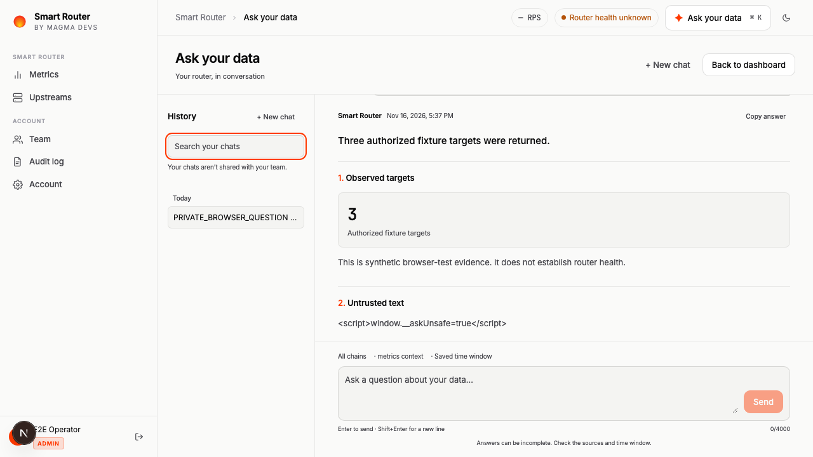
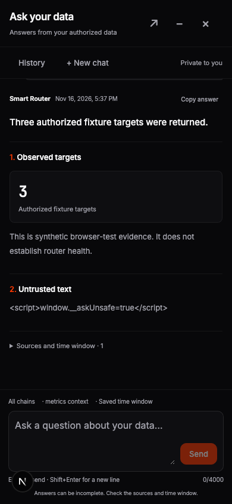

# MAG-4933 UI and browser verification

This slice stacks on [PR #394](https://github.com/Magma-Devs/smart-router-dashboard/pull/394).
No customer deployment/flag or cloud resource changed. The first four PRs have
passed their existing Quality Gate and Browser CI checks.

## Observed behavior

Four Chromium flows exercise the real browser → auth → HTTP API → durable worker
→ PostgreSQL → browser path. MCP/Bedrock responses alone are deterministic test
fixtures; these runs prove UI/integration behavior, not live provider availability.

- Panel/full switching preserves drafts and conversation identity; minimize keeps
  the dashboard interactive. Reload/deep links restore persisted messages/outcomes.
- Body-based search, grouped/paginated personal history, source/time evidence,
  copying and literal HTML rendering work. Source HTML executes no script.
- Another browser context containing only the session cookie and no local storage
  opens the same last full view/chat from server preferences.
- Another tab sees the active run and cannot submit another question. Stop persists
  without an assistant success; malformed/truncated output remains a failed turn
  after reload, with an edit/retry action.
- A read-only member can ask their own question and cannot view another person's
  chat, including after signing out/in in the same browser.
- A 26-question conversation loads its latest 50 messages, retrieves the earlier
  page without duplicates and preserves the reader's scroll position.
- Mobile has no horizontal overflow, uses the common modal focus/scroll layer,
  makes the dashboard inert while open, and restores it on Escape. Light desktop
  and dark mobile were visually inspected.

The disabled/self-hosted flow separately proves there is no top-bar entry, no
personal chat requests, no composer on the direct page and no API capability.
The existing eight account/2FA browser checks pass because the shell and session
bridge are shared. CI now runs account and Ask suites as separate jobs.

Seven targeted session-binding checks cover queued reads/writes after account
replacement, legitimate bearer refresh, and late unauthorized responses that must
not sign out a newer account. This is cache/request isolation; the API continues
to authenticate the real bearer and enforce all customer/person boundaries.

The actual HTTP/PostgreSQL suite includes 24 checks: the prior budget/lifecycle
coverage plus opaque cache scopes, POST search, context/error persistence and
additional valid originating pages. Normal workspace tests pass separately from
these opt-in checks. No mock pass is counted as a live-provider pass.

## Screenshots

These show synthetic test content only. The literal script text is an intentional
plain-text rendering test; the Next development indicator is not product UI.

## Remaining acceptance

Workspace tests: **3,701 passed**, plus **24** opt-in HTTP/PostgreSQL checks.
Workspace typecheck, API and production web builds pass. Lint has zero errors and
14 pre-existing warnings; the new Ask UI has no lint warnings. The four Ask flows
pass in Chromium (the initial three together, then the longer pagination case).
All eight account/disabled-feature browser checks pass together. The final
server-clock/provenance change also passes the 21 orchestration checks and
workspace typecheck. Screenshots above were inspected in light and dark themes.

Live Bedrock/model/counter/pricing, current customer MCP and runtime internal staff
OAuth/retention delivery still require proper runtime access. Controlled GK8
rollout, disable/rollback and pilot-start evidence belong to MAG-4934. Previously
observed Bedrock HTTP 403 and expired/insufficient AWS access remain open; no
credential or broader tenant grant was substituted.
