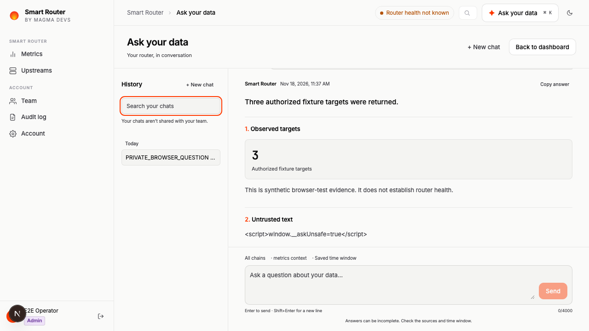
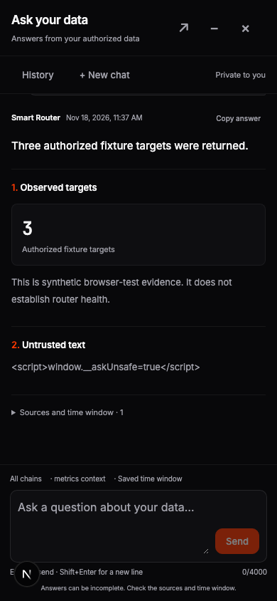

# PR #405: rebase and screenshots, 18 November 2026

The managed Ask branch was rebased onto main
`59ccd9b0f15b8b11d3beaa1f28a75b2bfb0db46e` (dashboard 0.70.0).
All 22 feature commits were replayed, with no merge commits. The application
revision tested locally is `1dbc34e5`; subsequent changes contain this evidence,
screenshots and release-documentation corrections only.

Conflicts in API configuration and the dashboard shell retain both Ask and
main's usage analytics/consent UI. The single proposed feature release is now
0.71.0, with its changelog above the existing 0.70.0 entry. No database migration
collision exists with this main revision; recheck main before merge.

## Flow verification

Story: a signed-in person opens Ask, submits a question through the real HTTP
API and PostgreSQL worker, then reads the persisted answer in the panel, full
view and mobile dialog.

| Boundary | Evidence |
| --- | --- |
| Browser UI and response rendering | Five Chromium Ask flows pass, including panel/full switching, reload, mobile focus, history pagination, sources, stop and failure states. |
| Browser authentication and HTTP API | Real sign-in/session requests, submissions and polling are exercised by those flows. |
| API, worker and persistence | Browser flows use actual PostgreSQL. A separate disposable database passes all 25 HTTP/PostgreSQL isolation, concurrency and accounting tests. |
| Provider response | MCP and Bedrock responses in these browser runs are deterministic fixtures. No fresh live-provider or deployed-customer acceptance is claimed. |

Local toolchain: Node 26.13.1 and pnpm 12.21.0, as pinned by the repository.
Frozen-lockfile install, runtime pin checks, shared/database builds, workspace
typecheck and all 4,246 workspace tests pass. The 25 opt-in PostgreSQL tests run
separately from the workspace tests. Lint passes with zero errors and 17 warnings.
API and web production builds pass.

Seven additional Chromium flows pass: all six usage-consent cases from main
and the disabled/on-prem Ask case. They verify consent still gates analytics,
its controls work in both themes and on mobile, and Ask remains unavailable
where disabled.

## Screenshots

Captured from the rebased application by `e2e/ask-specs/chat.spec.ts`, then
visually inspected. Content and accounts are synthetic. Literal script text is
an intentional plain-text security test; the Next development indicator is not
product UI. These screenshots do not establish live router health.

Full chat, desktop/light theme (1280 × 720):

Panel, mobile/dark theme (390 × 844):

The dated real-provider/staff/retention receipts remain in [LIVE.md](../LIVE.md)
and the linked JSON evidence. Their original scope and deployment limitations
still apply. Hosted checks must be evaluated on the pushed final head.
